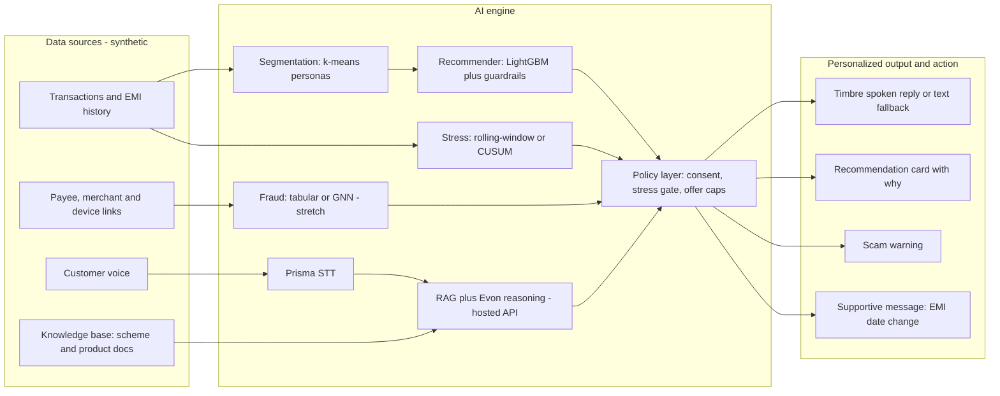

# Paisa Saathi: Product Documentation (v3 — Revised Scope)

*A voice-first, vernacular banking companion for irregular-income customers. Built on Gnani AI Prisma, Evon (hosted API) and Timbre, with segmentation, a recommender, and stress detection.*

Working name. Rename freely. Prototype built on **synthetic data only**. Solo developer build.

**One-line pitch:** A Hindi voice banking companion that helps irregular-income customers get the right loan, warns them about scams, and supports them instead of penalizing them when money is tight.

---

## 1. Pitch

Paisa Saathi speaks to first-time digital banking users in their own language, guides them through loan and KYC journeys without drop-off, recommends the right product at the right moment based on their real cash-flow rhythm, and warns them early about scams and financial stress, with support instead of penalties.

## 2. The tweak from the generic brief

The standard framing assumes salaried customers. Many Tier 2/3 customers have **irregular income** (vendors, gig workers, farmers), so salary-based signals fail. Paisa Saathi:

- models **cash-flow rhythm** (market-day inflows, seasonal peaks) instead of salary dates;
- is **voice-first** and mobile-first for users uncomfortable with text-heavy apps;
- treats stress detection as **support** (restructuring, reminders), never default flagging;
- has a built-in **anti-predatory guardrail**: stressed customers are never pushed new credit.

## 3. Users

| User | Need |
| --- | --- |
| **Customer** (e.g., "Ramesh", 42, vegetable vendor) | Understand products, apply for a small loan, avoid scams, in Hindi/Hinglish, on a phone |

> **Note:** A relationship manager ("Priya") banker dashboard is a stretch goal. The primary deliverable is the customer-facing experience.

## 4. Tiered scope

### 🔴 Must have (ship or fail)

| # | Component | What exactly |
| --- | --- | --- |
| 1 | **Voice loan journey (F1)** | Prisma STT → Evon/RAG → Timbre TTS (text fallback). 6-step flow. This IS the product. |
| 2 | **Rhythm-based segmentation (F2a)** | k-means on transaction rhythm features → 4 personas |
| 3 | **Recommender for 2 products (F2b)** | LightGBM propensity for small business loan + recurring deposit. No micro-insurance. |
| 4 | **Policy layer** | Hard-coded rules: stress gate, affordability check, frequency cap, no-pressure language |
| 5 | **Consent screen** | Granular toggles, plain-language notice in Hindi/English, withdraw control |
| 6 | **Customer UI** | React app (not PWA): mic button, journey screens, recommendation card with "Why?" |

### 🟡 Should have (adds real value, build if on track by Oct 28)

| # | Component | What exactly |
| --- | --- | --- |
| 7 | **Stress detection (F4)** | Simple rolling-window rule or CUSUM. Triggers "Would you like to move your EMI date?" — never shows the customer a stress score. |
| 8 | **Fraud detection (tabular)** | Graph-derived features (fan-in count per payee, shared devices, new-sender velocity) in LightGBM. Gives the "this payee received money from 14 new accounts in 2 hours" explanation without needing a GNN. |

### 🟢 Stretch (only if ahead of schedule after Oct 28)

| # | Component | What exactly |
| --- | --- | --- |
| 9 | **GNN (Graph Guard, F3)** | Upgrade tabular fraud model to GraphSAGE (PyTorch Geometric). Only if tabular fraud model is done. |
| 10 | **Minimal banker view (F5)** | Single page: stress queue table + fraud queue table. No Cytoscape, no fairness panel. |
| 11 | **GNN-vs-tabular ablation** | Only if the GNN is actually built. |

## 5. Conceptual architecture (data sources → AI engine → personalized output/action)

## 6. Features

### F1. Guided Journeys (Voice Companion, Gnani)

One journey is **fully working (loan application)**; onboarding and KYC are shown as working screens with simulated identity checks.

**Loan journey, 6 steps, "Step X of 6" always visible:**

1. **Language and mode:** choose Hindi/English; voice or text.
2. **Consent:** plain-language notice with separate toggles (see section 10).
3. **Identity (simulated):** demo ID step with a synthetic ID; no real Aadhaar/PAN.
4. **Income and business:** spoken answers confirmed on screen; pre-filled from synthetic transaction rhythm where consented.
5. **Offer:** product, amount, instalment size, with a spoken "why" and affordability check.
6. **Confirm:** summary read aloud, with an explicit yes/no.

**Personalization:** the question set, amounts and repayment schedule adapt to the customer's persona (a vendor's weekly repayment vs a farmer's post-harvest repayment). **Drop-off reduction:** save and resume, one question per screen, confirm-the-transcript step, "I didn't understand" fallback to typed input, and a human-help button. **Models:** Prisma (STT) → intent router → RAG + Evon (answers, form dialogue) → Timbre (TTS, beta; text fallback).

**Evon integration:** Evon 3.3 (30B-parameter Mamba2-Transformer Hybrid MoE) is used via **Gnani's hosted API** (`https://api.vachana.ai`), not self-hosted. The model supports Hindi/Hinglish natively with 128K context. API key is stored on the backend only, never exposed to the frontend.

### F2. Behavioral Segmentation and Next-Best-Product (ML)

- **Segmentation:** k-means (or Gaussian mixture) on rhythm features (inflow volatility, peak weekday, savings ratio, obligation ratio, category mix) → 4 personas.
- **Recommender:** LightGBM propensity for **2 products** (small business loan, recurring deposit), plus timing rule (suggest when balance is healthy and a repayment window is safe).
- **Explanation:** SHAP converted into one plain sentence ("You earn most on Fridays, so a weekly instalment fits").
- **Guardrails** apply before anything is shown (section 10).

### F3. Fraud Detection (Tabular baseline; GNN is stretch)

**Primary approach (must have):**
- Extract **graph-derived tabular features**: fan-in count per payee, shared device count, new-sender velocity, transaction amount anomalies.
- Train **LightGBM classifier** on these features.
- **Output:** risk score plus a rule-based explanation: "this payee received money from 14 new accounts in 2 hours."
- **Action:** warn by voice and require confirmation. Never silently block a customer.

**Stretch (only if ahead of schedule):**
- **Graph:** nodes = customers, UPI IDs, merchants, devices; edges = payments, shared device/phone links.
- **Model:** GraphSAGE or GAT (PyTorch Geometric) for node classification (mule/scam-linked).
- **Ablation:** report GNN-vs-tabular comparison.

### F4. Early Stress Signals (ML) — should have

- **Signals:** shrinking inflows, rising shortfall days, **missed and late EMIs**, near-miss EMIs, sudden spending shifts.
- **Model:** simple rolling-window rule or CUSUM (change-point detection via `ruptures` library) → stress score.
- **Intervention ladder:** low = gentle tip; medium = voice message offering to move the EMI date or reduce the instalment; high = human outreach. No punitive default flags.
- **Important:** the customer never sees a "stress score." They see: "Would you like to move your EMI date?" The score stays on the backend only.

### F5. Customer UI (React app)

- **Customer app (React + Vite + Tailwind, mobile-first):** mic button, journey screens, recommendation card with "Why?", safety alerts, consent toggles.
- **No PWA** — standard React app is sufficient for the demo.
- **Banker view** is a stretch goal: single page with a stress/fraud queue table if time permits.

## 7. End-to-end story

1. Ramesh asks in Hindi about a loan (F1) and gives consent.
2. His rhythm profile selects a suitable small loan and timing (F2); the stress gate confirms he is eligible to see a credit offer.
3. During the application a payment to a suspicious payee triggers a fraud warning (F3).
4. Weeks later his inflows dip and an EMI is missed; instead of a default flag he gets a supportive message with options (F4).

## 8. Stack

Python, FastAPI, LightGBM, scikit-learn, SHAP, ChromaDB/FAISS, sentence-transformer embeddings, SQLite; **React + Vite + Tailwind (mobile-first)**, MediaRecorder for mic, Recharts. The Gnani API key stays on the backend only.

**Gnani APIs (hosted, via `https://api.vachana.ai`):**
- **Prisma v2.5** — Speech-to-Text (REST for short clips)
- **Evon 3.3** — LLM chat completions (30B model, hosted by Gnani, not self-hosted)
- **Timbre v2.5** — Text-to-Speech (REST, beta; text fallback if unstable)

**Stretch only:** PyTorch Geometric (GNN), Cytoscape.js (graph viz).

## 9. Data and evaluation

**Synthetic data:** about 2,000 customers, 4 personas, 6 months of transactions, injected fraud rings, injected stress cases including **missed EMIs**, 30 to 50 self-recorded Hindi/Hinglish clips (some noisy), invented bank product sheets plus public scheme text for RAG.

> **Honesty note:** All metrics are on synthetic data. With synthetic data we inject the fraud rings and stress cases ourselves, so models will perform well partly because of how the data was built. Metrics demonstrate the pipeline works end-to-end, not real-world accuracy. This will be stated plainly in the write-up.

### Must-have metrics

| Component | Metric |
| --- | --- |
| Prisma | Word error rate (clean vs noisy) |
| Journey | **Completion rate and drop-off step** across 5 test runs |
| Fairness | One table: recommendation rate + fraud flag rate across 4 personas |

### Should-have metrics

| Component | Metric |
| --- | --- |
| RAG | Hit@3 on 10 to 15 test questions |
| Recommender | AUC vs "offer to all" baseline |
| Stress | Lead time before shortfall, false-alert rate |

### Stretch metrics

| Component | Metric |
| --- | --- |
| GNN | AUC, PR-AUC; ablation vs tabular LightGBM |

## 10. Ethical safeguards note

**Scope note:** the prototype is a demo on synthetic data, not a live data fiduciary. This section describes how the design is built to comply and what a bank deploying it would need to do. Verify exact legal wording against the official texts before quoting it.

### 10.1 Data privacy and consent (DPDP Act, 2023 and DPDP Rules, 2025)

- **Status:** the DPDP Rules, 2025 were notified on 13 November 2025, with a phased rollout. Consent Manager provisions commence about one year after notification (around November 2026), and the substantive obligations (notice, consent, breach reporting, among others) commence 18 months after (around May 2027). Secondary sources differ by a day on exact dates, so confirm in the Gazette.
- **Notice:** the consent screen shows a clear notice (what data, why, how long, how to withdraw), in Hindi and English, in plain language. The Rules provide for notice in English and the Eighth Schedule languages on request.
- **Granular, freely given consent:** separate toggles for (a) personalized recommendations, (b) stress monitoring, (c) fraud-graph analysis. Declining a toggle never blocks core banking in the demo.
- **Purpose limitation and minimisation:** each model uses only the fields it needs; voice recordings are not stored by default.
- **Withdraw and erase:** a visible "withdraw consent / delete my data" control; a consent ledger records grant, change and withdrawal with timestamps.
- **Security and breach readiness:** encryption at rest, access control for the banker view, audit logs, and a documented breach-response step.
- **Children:** the demo is for adults only. The Rules require verifiable parental consent for children's data.
- **Consent Manager:** note as future integration, since it becomes relevant from late 2026.

### 10.2 Data localization (RBI)

- **Rule:** RBI's circular of 6 April 2018 on *Storage of Payment System Data* (DPSS.CO.OD.No.2785/06.08.005/2017-2018) requires system providers to store the entire payment-systems data **only in India**, including end-to-end transaction details.
- **Design:** all transaction-type data, graph data and model artifacts stay in a local or India-hosted store; no foreign storage of payment data.
- **Open point to verify:** voice audio and text sent to Gnani's APIs. Check Gnani's docs and terms for processing region and retention. In the demo only synthetic text and your own recordings are sent, so no real customer data leaves your control.

### 10.3 Algorithmic bias

- **Test across groups:** compare recommendation rates, fraud-flag false-positive rates and stress-alert rates across personas, and ASR word error rate across accents/speakers in your clips.
- **Report** the gaps and the mitigation applied (reweighting, threshold review). Keep humans in the loop for high-impact cases.
- **Explainability:** every score has a plain-language reason (SHAP explanation).

### 10.4 Avoiding predatory nudging (hard-coded policy layer)

1. **Stress gate:** if stress score ≥ threshold, **no new credit offers are shown**; only support options (restructuring, savings tips).
2. **Affordability check:** proposed instalment must not exceed a set share of the customer's typical net inflow in the repayment period.
3. **Frequency cap:** at most one offer per customer per defined window; no repeated prompting after "not now".
4. **No pressure language:** no countdowns, scarcity or urgency; neutral wording.
5. **Offer log:** every offer records why it was shown and which rules passed, auditable.
6. **Customer control:** easy "stop recommendations" toggle.
7. **Never punitive:** missed EMIs lead to support offers and human outreach, not automatic default flags.

### 10.5 Alignment with RBI's FREE-AI framework

RBI's FREE-AI Committee report (13 August 2025) sets out seven "sutras": Trust is the Foundation, People First, Innovation over Restraint, Fairness and Equity, Accountability, Understandable by Design, Safety, Resilience and Sustainability, with 26 recommendations across six pillars. It is a committee framework, not a binding circular, but it is a useful design checklist.

| Sutra | How Paisa Saathi addresses it |
| --- | --- |
| People First | Voice-first, vernacular, human escalation |
| Fairness and Equity | Persona-level bias testing |
| Understandable by Design | "Why this?" explanations everywhere |
| Accountability | Offer and consent logs |
| Safety and Resilience | Text fallback, no silent blocking, never asks for OTP/PIN/CVV |
| Trust | Transparent consent, withdrawal control |

## 11. Schedule (Oct 5 to Nov 10, 2026) — voice-first, with buffer

| Dates | Milestone | Gate check |
| --- | --- | --- |
| **Oct 5-7** | API keys; one test call each to Prisma, Evon (hosted API), Timbre | **Gate:** all 3 APIs responding. If Timbre fails → commit to text fallback. |
| **Oct 8-14** | Synthetic data generator + bare-bones voice loop (Prisma → Evon → Timbre/text) in parallel | **Gate:** working voice loop AND complete dataset. If either missing → cut GNN entirely. |
| **Oct 15-21** | Segmentation, recommender (2 products), stress detection, policy layer, tabular fraud features in LightGBM | **Gate:** all ML models trained and producing outputs. If not → skip fraud entirely. |
| **Oct 22-28** | RAG setup (ChromaDB + Evon), loan journey backend (6-step state machine), Evon prompt engineering, connect voice loop to journey | **Gate:** user can speak Hindi, go through 6 loan steps, get recommendation with "Why?". If not → cut banker dashboard. |
| **Oct 29-Nov 2** | Customer UI (React): mic, journey screens, recommendation card, scam warning, consent screen. Stretch: minimal banker view (1 day). Integration. | |
| **Nov 3-4** | Bug fixes, evaluation numbers, **feature freeze Nov 4** | 2 days buffer before demo |
| **Nov 5-6** | Record demo video (3 beats) | |
| **Nov 7** | Written explanation: problem, users, architecture, approach, metrics, ethics note | |
| **Nov 8** | LinkedIn/X post | |
| **Nov 9** | Submit everything | |
| **Nov 10** | **Final deadline** (1 day buffer) | |

## 12. Submission checklist

- [ ] Project details updated in participant workspace
- [ ] Public demo video (YouTube unlisted or Drive public link)
- [ ] LinkedIn/X post with tag, #GnaniAI, #GreatIndianAIInternshipChallenge
- [ ] Written explanation: problem, users, architecture diagram, AI/ML approach, metrics, ethics note
- [ ] Post links included in the form or sent to organizers

## 13. Demo script — 3 beats (about 60 seconds)

| Time | Beat | What to show |
| --- | --- | --- |
| **0-25s** | **Voice loan journey** | Ramesh speaks in Hindi → system responds → "Step 2 of 6" visible → offer screen with amount |
| **25-42s** | **Recommendation + "Why?"** | Recommendation card: "Weekly repayment loan" + "You earn most on Fridays, so weekly instalments fit" |
| **42-55s** | **Stress gate or scam warning** | Pick whichever is more polished. Either: supportive message ("Would you like to move your EMI date?") OR fraud warning with explanation |
| **55-60s** | **Closing** | One sentence: "Banker dashboard tracks everything." Flash it if built. "Built on Gnani Prisma, Evon, and Timbre." |

> Show 3 beats, not 5. Pick stress gate OR scam warning for beat 3, not both.

## 14. Out of scope

Real KYC/Aadhaar/UPI/bureau calls, real customer data, more than 1 to 2 languages, all three journeys fully working, insurance/investments/credit cards beyond 2 products, native mobile app, real-time streaming infrastructure, custom GNN research architectures, PWA service worker/offline mode, self-hosted Evon (30B model requires enterprise GPU infrastructure).

## 15. Risks and fallbacks

| Risk | Fallback |
| --- | --- |
| Evon (30B) too heavy to self-host | **Use Gnani's hosted API at `api.vachana.ai` (decided)** |
| Timbre beta unstable | Text reply plus pre-generated demo audio |
| Language support limits | Hindi/Hinglish first; confirm others in docs |
| Credits (5,000) | Cache STT/TTS results; test on short clips |
| Scope creep | Freeze features on Nov 4 |
| API surprise (endpoint changes, downtime) | Discover in week 0 (Oct 5-7), not week 3 |
| Synthetic data inflating metrics | State plainly in write-up: "pipeline demo, not real-world accuracy" |

**Verify at docs.gnani.ai:** supported languages, streaming vs upload, audio limits, LLM API availability, credit use per call, and data processing/retention terms.

## 16. What NOT to spend time on

| Don't | Why |
| --- | --- |
| PWA service worker / offline | No demo value |
| Cytoscape.js graph viz | Unless GNN is actually built |
| Detailed fairness dashboard | One table in the writeup is enough |
| Legal citation deep-dive | Keep the "verify" caveat, move on |
| Multiple languages beyond Hindi | Out of scope |
| Polished banker dashboard | A table is fine, and it's stretch |
| Self-hosting Evon from HuggingFace | 30B model needs enterprise GPU; use the hosted API |
| 3 products | 2 products (loan + RD) is enough |