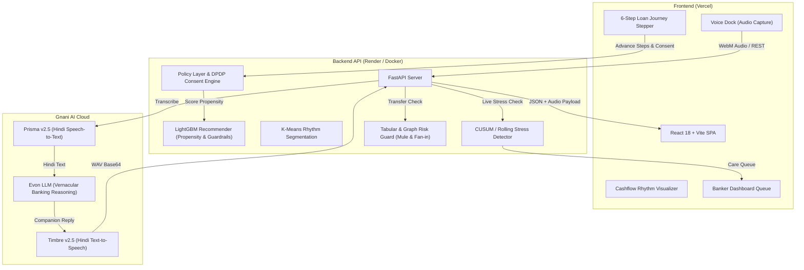

# Paisa Saathi (पैसा साथी) 🌾🎙️
> **A vernacular voice banking companion for irregular-income customers, powered by Gnani AI, Machine Learning, and DPDP-compliant guardrails.**

[](https://fastapi.tiangolo.com)
[](https://react.dev)
[](https://vitejs.dev)
[](https://www.typescriptlang.org)
[](https://tailwindcss.com)
[](https://www.gnani.ai/)
[](https://lightgbm.readthedocs.io/)
[](https://opensource.org/licenses/MIT)

---

## 📌 The Problem
Over 300 million Indians in Tier 2, Tier 3, and rural markets operate in the informal economy—as vegetable vendors, gig workers, and smallholder farmers. 

- **Irregular Inflows**: Their earnings spike on specific days (e.g., Friday Mandi collections or weekly market days) rather than on the 1st of each month.
- **Traditional Banking Fails Them**: Conventional credit models evaluate them as "unpredictable" or "high-risk" borrowers.
- **Punitive Treatment**: When cash flow temporarily dips, traditional banks issue harsh penalties and aggressive debt collection.
- **Digital Divide**: Complex, text-heavy English banking apps lead to massive drop-offs during KYC and loan applications.

---

## 💡 The Solution: Paisa Saathi
**Paisa Saathi** re-imagines digital financial inclusion with a voice-first, vernacular assistant that:
1. **Listens & Speaks in Plain Hindi**: Powered by Gnani AI's **Prisma STT**, **Evon LLM**, and **Timbre TTS** with automatic audio notes and bilingual subtitles.
2. **Models Cashflow Rhythm**: Analyzes transaction velocity and weekly market spikes (e.g., Mandi days) instead of rigid monthly salary dates.
3. **Offers DPDP-Compliant 6-Step Loan Journey**: Granular consent toggles with instant right-to-withdraw controls and pre-filled income from rhythm features.
4. **Non-Punitive Stress Care**: Detects cash-flow deceleration early and offers a **10-day zero-penalty EMI grace period** instead of default flags.
5. **Explainable Scam Guard**: Inspects outgoing transfers for mule account networks and shared devices, giving spoken warnings before money leaves.
6. **Proactive Banker Dashboard**: Gives relationship managers an early-warning care queue to support customers before default.

---

## 🏗️ Architecture



---

## 👥 Supported Personas

| Persona | Occupation | Inflow Rhythm | Pre-Approved Product |
|---|---|---|---|
| **Ramesh Kumar** (`C00000`) | Vegetable Vendor (Mandi Tier-2) | **Friday Peak** (₹2,800 Mandi collection) | ₹20,000 Micro-Loan (₹500/week) |
| **Sunita Bai** (`C00119`) | Cotton Smallholder Farmer | **Tuesday Peak** (Harvest sale cycle) | ₹45,000 Agri-Equipment Loan |
| **Amit Rawat** (`C00305`) | Gig Economy Delivery Partner | **Sunday Peak** (Weekend delivery rush) | ₹15,000 Fuel & Bike Maintenance Line |
| **Vikram Sen** (`C00481`) | Salaried Baseline | **1st of Month** (Fixed salary date) | ₹1,00,000 Personal Loan |

*You can also create custom personas directly via the in-app **+ Add Profile** modal.*

---

## 🚀 Key Features

### 1. 🎙️ Vernacular Voice Engine
- Real-time speech transcription via **Prisma STT**.
- Context-aware responses using conversational system prompts tailored for irregular-income earners.
- Audio synthesis via **Timbre TTS** streaming 24kHz Hindi audio directly into the browser.
- Full text fallback and audio replay on every conversation turn.

### 2. 📝 6-Step Loan Journey & Consent Engine
- **Step 1: Language & Mode** (Hindi / English, Voice / Text).
- **Step 2: DPDP Data Rights** (3 granular toggles + plain Hindi explanation + 1-click withdraw control).
- **Step 3: Identity Verification** (Demo verification flow).
- **Step 4: Income Confirmation** (Pre-filled from cash-flow rhythm).
- **Step 5: Personalized Offer** (Connected to propensity recommender & anti-predatory gate).
- **Step 6: Spoken Confirmation** (Spoken summary read aloud + contract generation).

### 3. 🛡️ Non-Punitive Financial Stress Care
- Monitors rolling 14-day cash-flow deceleration using change-point and rolling averages.
- Proactively suggests: *"Would you like to move your EMI date by 10 days with zero penalty?"*
- Hard policy guardrail: **Stressed customers are never pushed new predatory credit.**

### 4. 🚨 Explainable Transfer Risk & Scam Guard
- Analyzes counterparty device sharing, account age, and payee fan-in degree.
- Generates plain-language warnings: *"Is payee ke phone se 6 alag-alag khate jude hain."*
- Never silently cancels transfers—requires explicit voice confirmation.

### 5. 💼 Relationship Manager (Banker) Dashboard
- Live early-warning stress queue showing customers before loan default happens.
- Fraud and money mule investigation queue.
- Model performance metrics (AUC-ROC, precision, recall).

---

## 🛠️ Tech Stack

### Frontend
- **React 18** + **TypeScript**
- **Vite 6** (Fast bundling & HMR)
- **Tailwind CSS v4** + **Lucide Icons**
- Browser MediaRecorder Audio API

### Backend & Machine Learning
- **FastAPI** + **Uvicorn**
- **Gnani AI SDK / HTTP REST Client** (Prisma, Evon, Timbre)
- **Scikit-Learn** & **LightGBM** (Recommender & Fraud Tabular Models)
- **Pandas** & **NumPy** (Cashflow Rhythm Signal Processing)
- **Joblib** (Model Serialization)

---

## 💻 Local Setup & Development

### Prerequisites
- Python 3.10+
- Node.js 18+ & npm
- Valid [Gnani AI](https://www.gnani.ai/) API Key

### 1. Clone the repository
```bash
git clone https://github.com/shaambhavi-dubey/paisa-saathi.git
cd paisa-saathi
```

### 2. Configure Environment Variables
Copy `.env.example` to `.env`:
```bash
cp .env.example .env
```
Edit `.env` and fill in your Gnani AI API credentials:
```env
GNANI_API_KEY=your_actual_gnani_key
GNANI_BASE_URL=https://api.vachana.ai
HOST=0.0.0.0
PORT=8000
```

### 3. One-Click Launch (Windows)
- **Development Mode** (Hot reloading on frontend :5173 & backend :8000):
  ```bash
  run_dev.bat
  ```
- **Production Mode** (Builds frontend and serves on :8000):
  ```bash
  run_production.bat
  ```

### 4. Manual Setup

**Backend**:
```bash
python -m venv venv
# Windows:
.\venv\Scripts\activate
# Linux/macOS:
source venv/bin/activate

pip install -r requirements.txt
uvicorn backend.app:app --reload --port 8000
```

**Frontend**:
```bash
cd frontend
npm install
npm run dev
```
Open [http://localhost:5173](http://localhost:5173) in your browser.

---

## 🧪 Testing

Run the full end-to-end integration and API test suite:
```bash
pytest tests -v
```
All 7 tests verify:
- Timbre TTS audio synthesis
- Prisma STT speech-to-text round trip
- Evon conversational reasoning
- 6-step loan journey state machine & consent withdrawal
- Voice REST endpoints (`/api/voice/process-text`, `/api/voice/process-audio`)

---

## ☁️ Deployment

### Split Deployment (Vercel + Render)

1. **Backend on Render**:
   - Create a Web Service connected to this repository.
   - Build Command: `pip install -r requirements.txt`
   - Start Command: `uvicorn backend.app:app --host 0.0.0.0 --port $PORT`
   - Add environment variable `GNANI_API_KEY`.

2. **Frontend on Vercel**:
   - Import this repository on Vercel.
   - Set **Root Directory** to `frontend`.
   - Framework Preset: **Vite**.
   - Add environment variable: `VITE_API_URL=https://<your-render-app>.onrender.com`.

### Docker Deployment
```bash
docker compose up --build -d
```
Access the unified application on `http://localhost:8000`.

---

## 📄 License
This project is open-source under the [MIT License](LICENSE).
